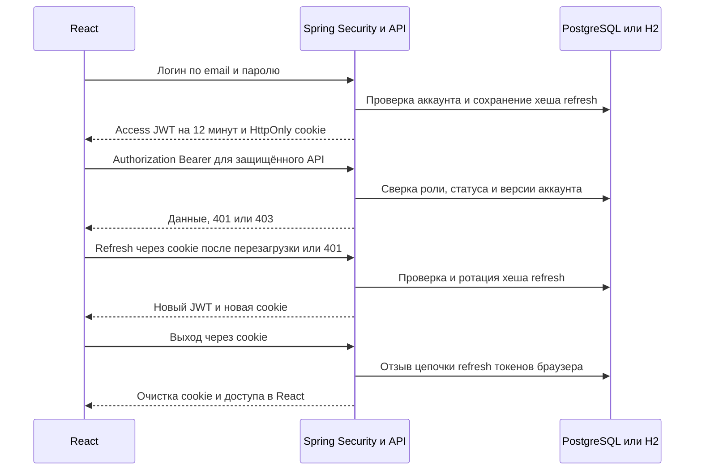

# Price Analyzer

Учебный проект «Разработка web-приложения анализа цен на товары».

## Запуск текущей версии

Нужны JDK 21, Maven, Node.js 22 и существующая локальная PostgreSQL. Укажите JDBC URL, имя и пароль пользователя базы в терминале один раз.

```sh
./scripts/dev-up.sh setup
./scripts/dev-up.sh
```

Настройка сохраняет параметры подключения и постоянный JWT-ключ в `~/.config/price-analyzer/dev.conf` с правами `600` (или в `$XDG_CONFIG_HOME/price-analyzer/dev.conf`). Скрипт использует уже работающую PostgreSQL либо запускает указанный при настройке существующий кластер через `pg_ctl`. Для системной службы с отдельным владельцем запустите её штатными средствами macOS, если она остановлена. Базу и роль PostgreSQL скрипт не создаёт. Spring Boot по умолчанию использует профиль `postgres`. H2 используется в тестовых конфигурациях.

Откройте http://localhost:5173. Интерфейс обращается к backend на порту 8080. Если один из этих портов занят, запуск остановится с сообщением. Остановите приложение клавишами Ctrl+C. Регистрация на сайте выдаёт роль `USER`. Роль `ADMIN` также позволяет менять каталог и цены, импортировать файлы и настраивать срок хранения истории.

Для проверки почты установите Mailpit командой `brew install mailpit` и запустите `./scripts/dev-up.sh --mailpit`. Приложение отправляет письма через локальный SMTP на порту 1025. Откройте [входящие Mailpit](http://127.0.0.1:8025), на сайте нажмите «Забыли пароль?» и введите адрес зарегистрированного тестового аккаунта. Ссылка из письма действует 30 минут и используется один раз. Mailpit хранит локальные письма в `mailpit.db` рядом с `dev.conf`, поэтому они доступны после перезапуска. Оба порта Mailpit слушают только loopback.

После первого запуска выполните `./scripts/dev-up.sh seed` из второго терминала, чтобы добавить демонстрационный каталог в локальную БД `price_analyzer` под ролью `price_user`. Команда добавляет четыре помеченных товара с вымышленными ценами, тремя магазинами и пятью неделями истории. Повторный запуск пропускает уже существующие товары и сохраняет их цены.

Из второго терминала проверьте число активных администраторов командой `./scripts/dev-up.sh admin status`. Создайте аккаунт через `./scripts/dev-up.sh admin create` или смените пароль существующего активного администратора через `./scripts/dev-up.sh admin reset`. Команды спрашивают email и скрывают ввод пароля. Смена пароля отзывает токены. Создание с занятым email отклоняется, поэтому существующий USER не повышается до ADMIN. Войдите на сайте с выбранным email и паролем.

В разделе «Управление» администратор задаёт срок хранения. Значение `0` сохраняет историю бессрочно. До первого сохранения настройки действует `app.prices.retention-days`.

## Избранное и уведомления

Сердечко в каталоге добавляет товар в личное избранное. Колокольчик показывает непрочитанные уведомления и обновляет счётчик каждые 45 секунд на активной странице. В уведомлении видны товар, магазин и изменение цены. В настройках можно выбрать все изменения, только снижение или отключить новые уведомления. Выбор и отметки о прочтении хранятся в БД.

Действие «Изменить цену» у последнего предложения магазина добавляет новую запись за ту же дату и сохраняет предыдущую. Импорт CSV и XLSX пропускает точные повторы по товару, магазину, дате и цене. Новая сумма за ту же дату дополняет историю. Уведомление создаётся при изменении последней цены магазина. Первое наблюдение, неизменившаяся сумма и записи за более ранние даты уведомлений не создают.

В разделе «Импорт / экспорт» USER и ADMIN могут скачать историю цен в XLSX. ADMIN может загрузить этот файл обратно или скачать отдельный шаблон для новых наблюдений. CSV сохранён в API для совместимости с прежними лабораторными и машинного обмена.

В «Отчётах» выберите товар, чтобы включить линейный график цен по магазинам. Сводные цены считаются по последнему наблюдению в выбранном периоде для каждой пары «товар / магазин». Кольцо в PDF и столбцы в XLSX показывают количество записей по магазинам. Во вкладке «Исходные данные» XLSX доступны отдельные наблюдения.

## JWT-аутентификация

Spring Security OAuth2 Resource Server проверяет подпись HS256, алгоритм, `iss`, `aud` и окно действия access JWT. Токен содержит идентификатор аккаунта `sub`, роль, версию авторизации, поля `iat`, `nbf`, `exp` и уникальный `jti`. Для каждого защищённого запроса сервер дополнительно сверяет роль, версию и статус аккаунта с БД. Политика `STATELESS` исключает использование HTTP-сессии для входа.



React держит access JWT в памяти. Cookie `pa_refresh` передаётся только к `/api/auth`, использует `HttpOnly` и `SameSite=Strict`. Срок цепочки refresh — 7 дней с момента входа. Сервер хранит SHA-256 хеши и отзывает всю цепочку при повторном предъявлении уже использованного refresh-токена. React ограничивает повтор запроса после `401` одной попыткой и использует Web Locks для координации между вкладками в браузерах с поддержкой API.

| Маршрут | Поведение |
|---|---|
| `POST /api/auth/register` | Принимает JSON с `email` и `password`. Создаёт `USER` |
| `POST /api/auth/login` | Принимает JSON с `email` и `password`. Возвращает `accessToken`, `tokenType`, `expiresIn`, `user` и устанавливает refresh cookie |
| `POST /api/auth/refresh` | Обновляет access JWT без пароля, ротирует cookie. Ответ имеет ту же структуру, что и логин |
| `POST /api/auth/logout` | Отзывает цепочку refresh и очищает cookie. Уже выданный access JWT может действовать до истечения 12 минут |
| `GET /api/auth/me` | Возвращает `email` и `role` после проверки Bearer |
| `POST /api/auth/password/request`, `POST /api/auth/password/reset` | Запрос письма и сброс по одноразовой ссылке |
| `POST /api/auth/password/change` | Принимает Bearer и JSON с `currentPassword` и `newPassword`. Смена или сброс пароля отзывает все прежние access и refresh токены аккаунта |

Логин, refresh, logout, сброс и смена пароля требуют точного `Origin` и заголовка `X-Price-Auth: 1`. Защищённые маршруты данных и скачивание CSV, PDF и XLSX требуют `Authorization: Bearer`.

| Роль | Доступ |
|---|---|
| `USER` и `ADMIN` | Просмотр каталога, цен, истории и аналитики. Отчёты и экспорт. Личное избранное, уведомления и их настройки |
| `ADMIN` | Создание, редактирование и удаление товаров и цен. Импорт CSV/XLSX. Административные настройки, включая срок хранения истории |

Для развёртывания передайте `APP_JWT_SECRET` из защищённого хранилища. Он должен содержать Base64 от 32 или более случайных байт. Значения по умолчанию у ключа нет. Экземпляры одного развёртывания используют один ключ, issuer и audience. `APP_JWT_ISSUER` и `APP_JWT_AUDIENCE` при необходимости задаются окружением. Укажите публичный HTTPS-адрес интерфейса без пути и завершающего слеша в `APP_AUTH_ORIGIN`. Для HTTPS сервер добавляет `Secure` к cookie. Передавайте `/api` через тот же origin, что и интерфейс. Локальный HTTP разрешён для loopback, по умолчанию `http://localhost:5173`. Для входа через IP настройте точный origin, например `http://127.0.0.1:5173`.

При переходе с серверных сессий всем пользователям нужно войти заново. Схема БД дополняется при старте без изменения паролей, ролей и пользовательских данных. Ротация ключа подписи инвалидирует существующие access JWT. Действующая refresh cookie позволяет получить токен с новым ключом.

Для восстановления пароля задайте `SPRING_MAIL_HOST`, `SPRING_MAIL_PORT`, `SPRING_MAIL_USERNAME`, `SPRING_MAIL_PASSWORD`, `APP_AUTH_FROM_ADDRESS` и `APP_AUTH_RESET_BASE_URL`. Последний параметр — адрес интерфейса по HTTPS. Для локального теста допустим HTTP на loopback. Почтовые секреты передавайте через окружение.

## Стек

- Frontend: React, Vite, ESLint, Vitest.
- Backend: Java 21, Spring Boot, Maven, JUnit/MockMvc, JaCoCo.
- CI: GitHub Actions.
- Правила коммитов: Conventional Commits + проверка pull request через commitlint.

## Структура

```text
.github/workflows/  # CI, метрики и проверка commit messages
backend/            # Spring Boot API и тесты
frontend/           # React/Vite, lint и unit-тесты
docs/lab5_report.md # текст отчёта для лабораторной работы
```

## Локальная проверка сообщений коммитов

В корне репозитория выполни `npm install`. Husky подключит локальный `commit-msg` hook, который проверяет сообщение коммита через commitlint. Проверка на GitHub дополнительно выполняется workflow `commit-check.yml`.

## Локальный запуск проверок

### Frontend

```bash
cd frontend
npm install
npm run lint
npm run test:coverage
npm run build
```

### Backend

```bash
cd backend
mvn verify
```

CI устанавливает зависимости из `frontend/package-lock.json` через `npm ci` и запускает Maven, Vitest и Playwright. Для сквозного прогона локально установите Chromium командой `cd frontend && npx playwright install chromium`, затем выполните `npm run test:e2e` из этой папки.

## Ветки

- `main` — стабильная версия.
- `develop` — интеграционная ветка.
- `feature/<краткое-название>` — новая функциональность.
- `fix/<краткое-название>` — исправление ошибки.
- `release/<версия>` — подготовка релиза.

Все изменения в `main` и `develop` проводятся через Pull Request после успешных проверок GitHub Actions.

## Формат коммитов

`type(scope): краткое описание`

Примеры:

- `feat(catalog): add product list`
- `fix(auth): handle invalid credentials`
- `test(prices): cover average price calculation`
- `docs(readme): describe local setup`
- `ci(github-actions): upload coverage report`

Типы: `feat`, `fix`, `docs`, `style`, `refactor`, `test`, `build`, `ci`, `perf`, `chore`, `revert`.

## GitHub settings, которые нужно включить вручную

1. Создать на GitHub пустой репозиторий, например `price-analyzer`.
2. Загрузить в него файлы этого набора.
3. В `Settings → General → Pull Requests` при желании отключить merge commit и оставить squash merge.
4. В `Settings → Branches` создать rulesets/правила для `main` и `develop`: Require a pull request before merging; Require status checks to pass; Block force pushes; Restrict deletions. Для `main` также требовать успешные CI-проверки.
5. После первого успешного запуска Actions выбрать в списке required status checks фактические имена проверок `quality-build-metrics` и `commitlint`, которые отображаются в GitHub. На GitHub Free доступность защиты веток зависит от видимости репозитория и возможностей тарифа; перед сдачей проверь это в настройках аккаунта.
6. Создать ветки `develop`, затем работать в `feature/...` и открывать Pull Request в `develop`; выпускать релиз через PR из `release/...` в `main`.

Точные действия и снимки экрана нужно сделать уже в собственном GitHub-репозитории. Сам этот архив не создаёт репозиторий и не меняет настройки аккаунта.

## Прототипирование (лабораторная работа №6)

В `frontend/` подготовлен интерактивный прототип: каталог товаров, ручной ввод цены, сравнение предложений по магазинам и график истории цен. Данные хранятся в браузере (`localStorage`), backend и PostgreSQL пока не подключены.

Инструкция по запуску: [`docs/lab6_run_guide.md`](docs/lab6_run_guide.md). Текст отчёта: [`docs/lab6_report.md`](docs/lab6_report.md).

Запуск прототипа:

```bash
cd frontend
npm install
npm run dev
```

## История и импорт

В шаблоне XLSX один лист с заголовками `productId | store | price | date` в первой строке. Укажите ID существующего товара, название магазина, положительную цену с точностью до копеек и дату как ячейку Excel или текст `YYYY-MM-DD`. Магазины с одинаковым названием сопоставляются без учёта регистра. Точный повтор товара, магазина, цены и даты пропускается. Новая сумма за ту же дату добавляет наблюдение. При ошибке откатывается весь импорт.

Выгрузка `price-history.xlsx` содержит ID и название товара, магазин, цену и дату. При обратном импорте товар определяется по ID. Файлы до 10 000 наблюдений и 4 МиБ можно загрузить целиком. Для более длинной истории укажите товар или период выгрузки. Отчёт из раздела «Отчёты» предназначен для анализа.

`APP_PRICES_RETENTION_DAYS` по умолчанию равно `0` и хранит историю бессрочно. При положительном значении ежедневная очистка в 03:00 по часовому поясу сервера удаляет записи строго раньше даты «сегодня минус срок хранения». Перед включением очистки выберите срок для рабочей базы.

## Сравнение и отчёты

Укажите товар и период на странице сравнения. Для каждого магазина используется последнее наблюдение за период. На графике можно навести указатель на точку или выбрать её с клавиатуры.

В разделе «Отчёты» доступны фильтры периода, категории и магазина и группировка по категориям, магазинам или товарам. Для каждого товара в магазине рассчитывается изменение от первой цены до последней за период. Сводные суммы в рублях и процентах усредняются по сериям с наблюдениями минимум в две разные даты. PDF и XLSX используют те же фильтры и расчёт.
